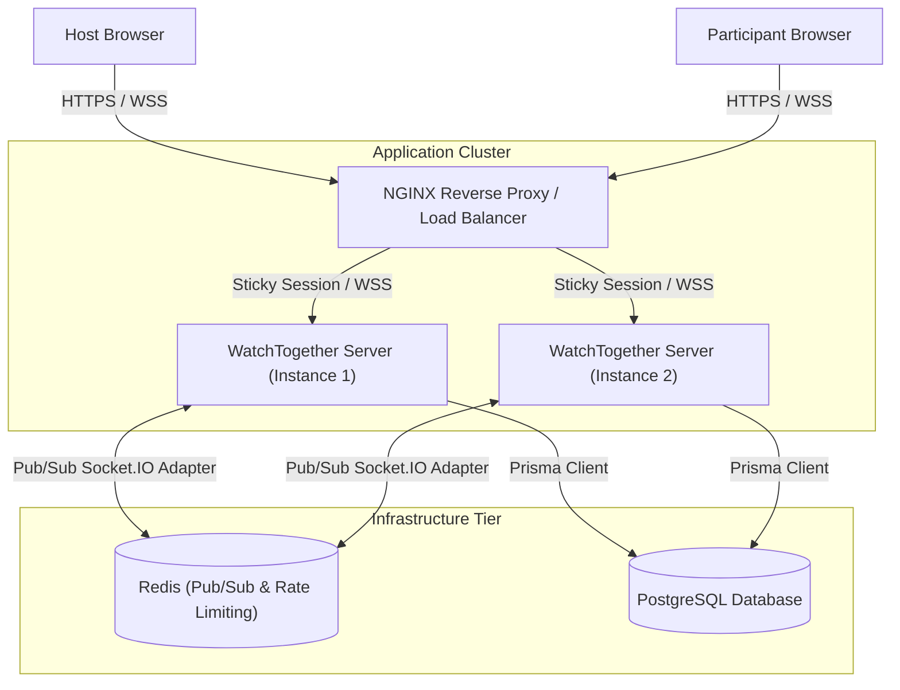
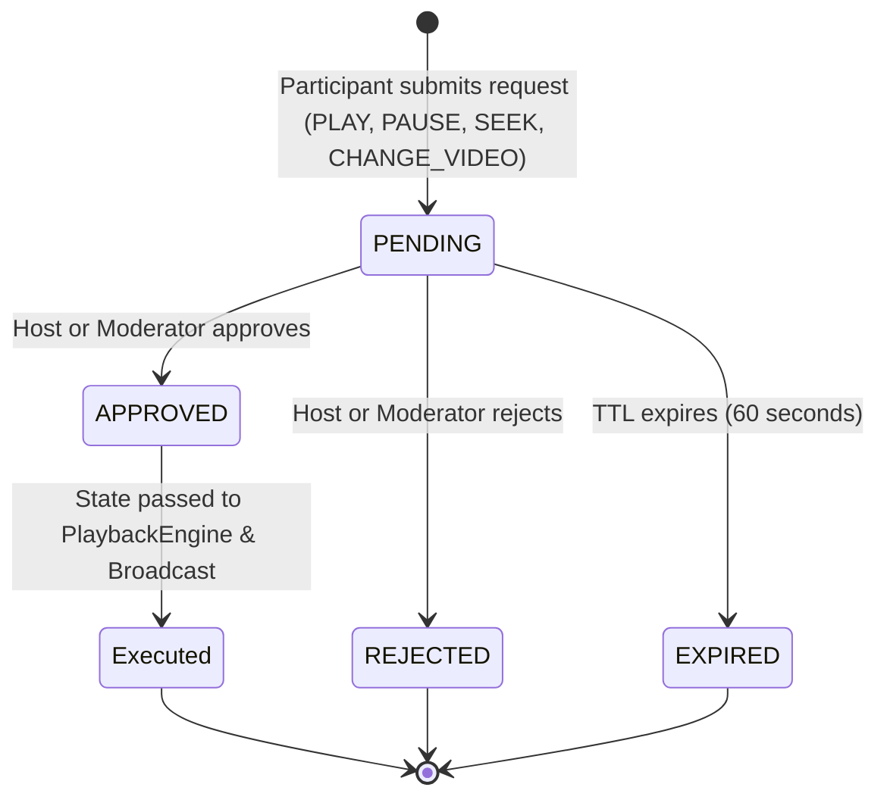

# WatchTogether — Architecture & System Design

WatchTogether is a production-grade, real-time synchronized YouTube watch party web application built with TypeScript, Node.js, Express, Socket.IO, Prisma ORM, PostgreSQL, Redis, and React.

---

## 1. High-Level System Architecture



---

## 2. Real-Time Synchronization Engine

The platform guarantees sub-second synchronization across all connected clients using an authoritative server timeline model.

### 2.1 Authoritative Playback State Model

Each room maintains an atomic `PlaybackState` record:

```typescript
interface PlaybackState {
  videoId: string;        // 11-character YouTube video ID
  videoTitle?: string;    // Human-readable title
  status: 'PLAYING' | 'PAUSED' | 'BUFFERING';
  position: number;       // Authoritative position in seconds
  timestamp: number;      // Epoch milliseconds when position was recorded
  version: number;        // Monotonic sequence number for concurrency control
  updatedBy: string;      // Actor display name
}
```

### 2.2 Expected Position Calculation

When playback is active, the authoritative expected position at any instant $t_{\text{now}}$ is computed as:

$$\text{expectedPosition} = \begin{cases} 
\text{storedPosition} + \frac{t_{\text{now}} - \text{timestamp}}{1000} & \text{if } \text{status} = \text{'PLAYING'} \\
\text{storedPosition} & \text{if } \text{status} = \text{'PAUSED'}
\end{cases}$$

### 2.3 Drift Correction Algorithm & Echo Loop Prevention

1. **Drift Thresholding**:
   - Clients compare local player time $t_{\text{local}}$ with $\text{expectedPosition}$.
   - If $|t_{\text{local}} - \text{expectedPosition}| > 2.0\text{ seconds}$, the client triggers `player.seekTo(expectedPosition, true)`.
   - Small timing variations ($< 2.0\text{s}$) are ignored to prevent micro-stutter and audio distortion.
2. **Echo Loop Prevention**:
   - When the client updates its player to match an incoming server sync update, it sets `isSyncingRef.current = true`.
   - YouTube `onStateChange` callbacks generated as a result of programmatic player adjustments are discarded and not re-emitted to the server.
3. **Heartbeat Broadcast**:
   - A server-side `SyncEngine` broadcasts authoritative state every 3,000ms to correct any accumulated network jitter or dropped packets.

---

## 3. Role-Based Access Control (RBAC)

The application enforces strict server-side authorization. Client roles displayed in the UI are for usability only; the backend verifies room membership and role on every single operation.

| Capability | Host (Crown) | Moderator (Shield) | Participant (User) |
|---|:---:|:---:|:---:|
| **Play / Pause** | ✅ Direct | ✅ Direct | ❌ Must Request |
| **Seek Timeline** | ✅ Direct | ✅ Direct | ❌ Must Request |
| **Change Video** | ✅ Direct | ✅ Direct | ❌ Must Request |
| **Promote / Demote Roles** | ✅ Yes | ❌ No | ❌ No |
| **Remove / Eject Participants** | ✅ Yes | ❌ No | ❌ No |
| **Approve / Reject Requests** | ✅ Yes | ✅ Yes | ❌ No |
| **Submit Action Requests** | ❌ (Has Direct Control) | ❌ (Has Direct Control) | ✅ Yes |
| **Send Chat Messages** | ✅ Yes | ✅ Yes | ✅ Yes |

---

## 4. Participant Request State Machine



- **Spam Prevention**: Maximum 3 concurrent pending requests per user.
- **Self-Approval Protection**: A participant cannot approve their own requests.
- **Atomic Transition**: Database update ensures a request is resolved exactly once.

---

## 5. Horizontal Scaling & Multi-Instance Clustering

1. **Socket.IO Redis Adapter**:
   - When multiple backend Node.js instances run behind Nginx or an application load balancer, WebSocket broadcasts (e.g. `io.to(roomId).emit(...)`) are published to Redis Pub/Sub channels.
   - All server instances receive the event and broadcast to their locally attached client sockets.
2. **Sticky Sessions**:
   - Nginx is configured with `ip_hash` to ensure sticky sessions during HTTP long-polling handshake before upgrading to pure WebSockets.
3. **Zero-Dependency Local Fallback**:
   - When `REDIS_URL` is omitted, the application runs with an in-memory adapter for lightweight local development.
